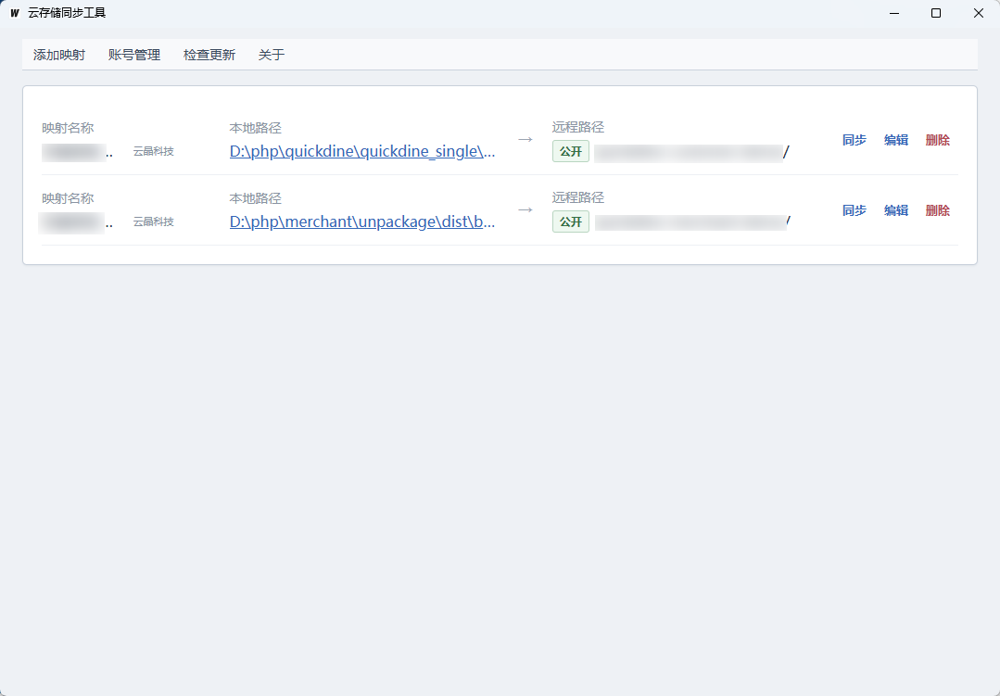
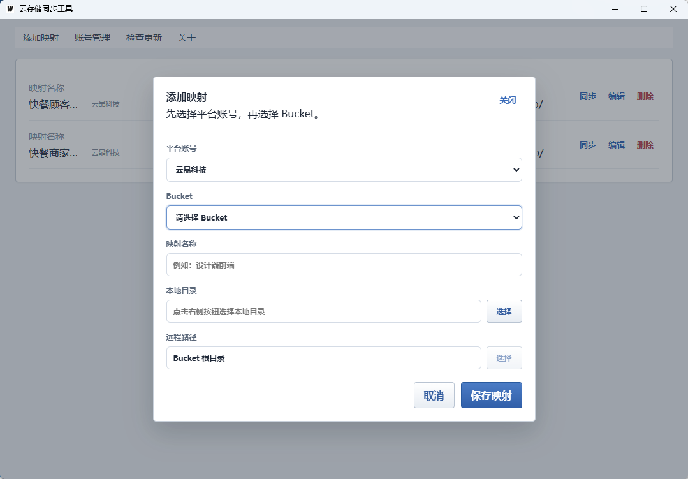
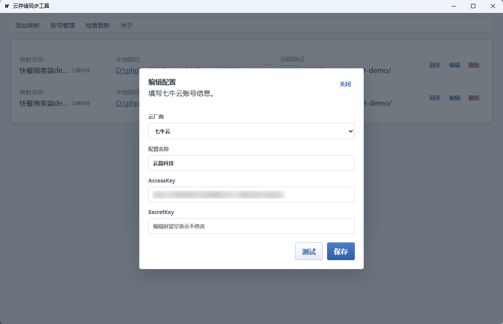
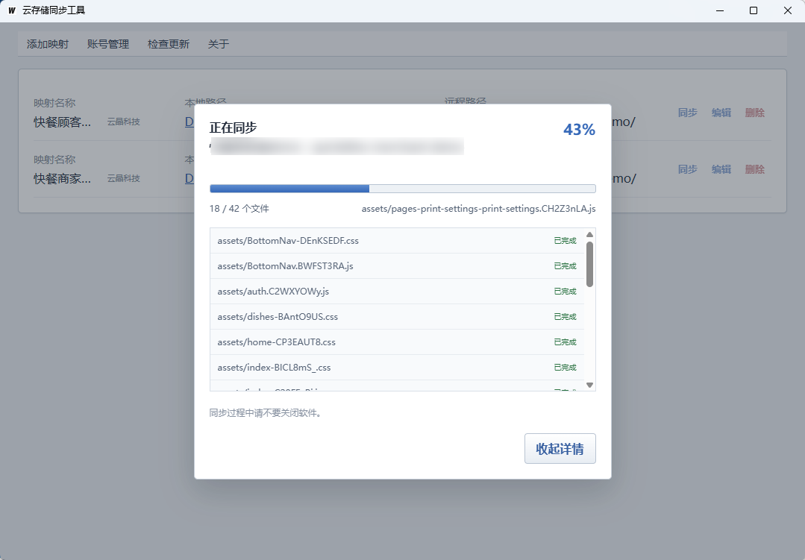

# 云存储同步工具

这是一个 Windows 本地优先的云存储文件同步工具，支持本地目录与云端 Bucket 映射，计划支持：

- 多个云平台账号；
- 多个 Bucket；
- 本地目录与远程网站目录绑定；
- 本地版本与线上版本比较；
- 覆盖上传和清空后上传；
- 清空文件后删除 Bucket，并同步清理本地映射配置；
- 上传完成后刷新 CDN；
- SQLite 配置和同步日志；
- Windows DPAPI 凭据保护。

七牛云能力使用官方 Go SDK `github.com/qiniu/go-sdk/v7`，包括文件列表、文件上传、远程文件删除、清空后删除 Bucket 和 CDN URL 刷新，不调用 Q Shell。

凭据文件只保存 DPAPI 加密后的密文，不保存明文 SecretKey。凭据存储通过 `credentials.Store` 接口抽象，后续可以接入 macOS Keychain、Linux Secret Service 或加密备份文件。

## 当前状态

当前版本先完成 Go 核心工程的基础层：

- SQLite 数据库初始化和迁移；
- 云平台、账号、Bucket、网站、CDN 绑定和同步日志表；
- 凭据存储抽象；
- Windows DPAPI 凭据实现骨架。

## 界面截图

### 映射列表

### 添加映射

### 编辑账号

### 同步进度

